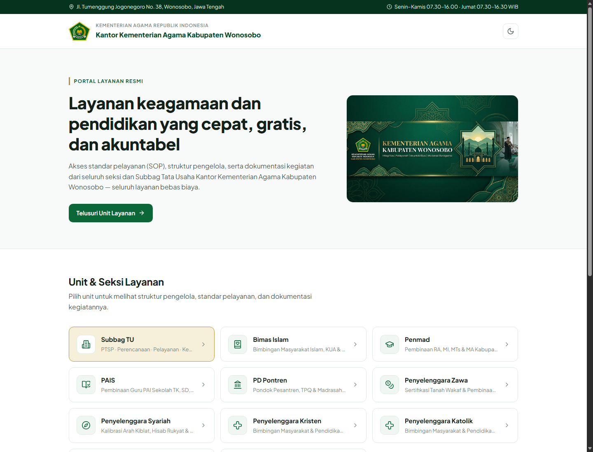
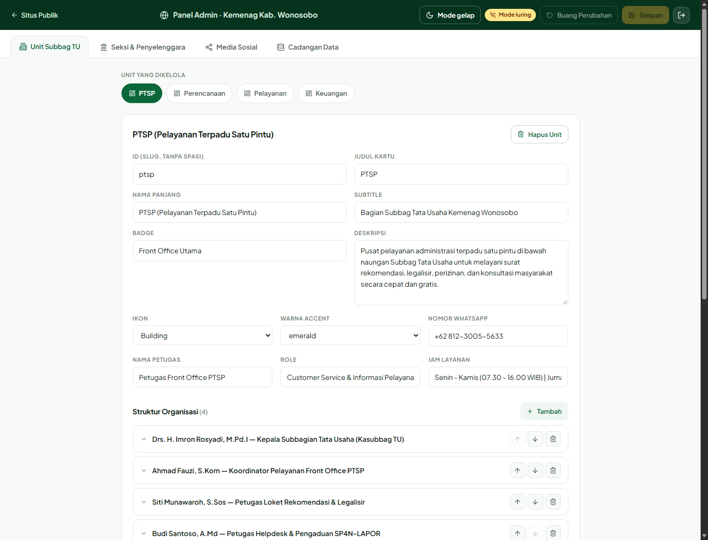

# Portal Kemenag Kabupaten Wonosobo

Portal layanan Kantor Kementerian Agama Kabupaten Wonosobo: struktur organisasi,
standar pelayanan (SOP), galeri foto/video, dan kanal resmi tiap seksi serta
Subbag Tata Usaha.

Frontend React + Vite, backend Express ringan dengan basis data **MySQL/MariaDB**
(lihat `server/db.js`), panel admin di `#/admin`.

## Tampilan

**Halaman publik**



**Panel admin**



Screenshot panel menunjukkan mode luring; perubahan pada mode ini hanya
tersimpan di browser operator.

## Kebutuhan

- Node.js 20.12 atau lebih baru (server memakai `process.loadEnvFile`)
- MySQL 8 atau MariaDB 10.3+ yang berjalan dan dapat dijangkau

## Menyiapkan basis data

Buat database + user khusus aplikasi (sekali saja, dengan akun admin MySQL).
Ganti `<kata-sandi-database-acak>` dengan kata sandi acak yang sama seperti
`DB_PASSWORD` di `.env`:

```sql
CREATE DATABASE IF NOT EXISTS kemenag_wsb
  CHARACTER SET utf8mb4 COLLATE utf8mb4_unicode_ci;

CREATE USER IF NOT EXISTS 'kemenag_wsb'@'127.0.0.1'
  IDENTIFIED BY '<kata-sandi-database-acak>';
CREATE USER IF NOT EXISTS 'kemenag_wsb'@'localhost'
  IDENTIFIED BY '<kata-sandi-database-acak>';

GRANT ALL PRIVILEGES ON kemenag_wsb.* TO 'kemenag_wsb'@'127.0.0.1';
GRANT ALL PRIVILEGES ON kemenag_wsb.* TO 'kemenag_wsb'@'localhost';
FLUSH PRIVILEGES;
```

Skema tabelnya dibuat otomatis oleh `server/db.js` saat peladen pertama kali
dijalankan (`ensureSchema`), lalu diisi data bawaan paket bila masih kosong.

## Menjalankan saat pengembangan

Butuh dua terminal:

```bash
npm install
cp .env.example .env     # isi ADMIN_PASSWORD dan DB_PASSWORD dengan nilai unik
npm run server           # API + unggahan di http://localhost:8392
npm run dev              # Vite di http://localhost:8391 (proxy /api & /uploads)
```

Buka <http://localhost:8391>. Panel admin: <http://localhost:8391/#/admin>.

## Menjalankan di produksi

```bash
npm run build            # hasil ke dist/
npm start                # satu proses: API sekaligus peladen dist/ di port 8392
```

Bila MySQL tidak terjangkau, peladen **berhenti dengan pesan galat yang jelas**
dan tidak menyajikan data apa pun — sesuai keputusan untuk memakai MySQL
sebagai satu-satunya sumber kebenaran (tanpa berkas cadangan).

## Panel admin

- Masuk memakai `ADMIN_PASSWORD` dari `.env` (minimal 12 karakter). Server
  menolak mulai bila kata sandi belum diatur atau masih memakai nilai bawaan.
  `DB_PASSWORD` juga wajib diisi.
- Maksimal 5 percobaan masuk gagal per alamat IP dalam 15 menit pada satu
  proses server. Di balik reverse proxy, atur proxy tepercaya sebelum
  mengandalkan alamat IP untuk pembatasan ini.
- Tombol **Simpan** menulis seluruh snapshot ke MySQL dalam satu transaksi, jadi
  perubahan langsung tampil untuk semua pengunjung; bila transaksi gagal, data
  lama tetap utuh.
- Berkas yang diunggah (foto pegawai, foto/video kegiatan, PDF SOP resmi)
  disimpan di `uploads/` — maksimal 200 MB per berkas, jenis
  PNG/JPEG/WebP/PDF/MP4/WebM/MOV.
- PDF yang dibuat otomatis ditandai sebagai draf; unggah dokumen yang sudah
  disahkan untuk menyediakan berkas SOP resmi.
- Menu **Cadangan Data** untuk ekspor/impor JSON yang mudah dibaca (impor juga
  mendukung cadangan gzip `.kewbak` lama) dan reset ke data bawaan
  (`POST /api/reset`, mengisi ulang dari `src/data.js`).
- Bila backend tidak aktif (mis. situs diterbitkan sebagai hosting statis),
  panel otomatis turun ke **mode luring**: perubahan hanya tersimpan di
  browser operator, memakai PIN luring yang tertanam di `src/admin/AdminApp.jsx`.
  Mode ini bukan autentikasi server dan tidak menyinkronkan perubahan; gunakan
  backend dan `ADMIN_PASSWORD` untuk pengelolaan data bersama.

## Skema MySQL

| Tabel | Isi |
| --- | --- |
| `unit` | 1 baris per unit (`jenis`: `subbag` untuk PTSP dst., `seksi` untuk kartu beranda) + kolom kontak |
| `struktur` | personil tiap unit |
| `layanan` | layanan/SOP tiap unit |
| `layanan_syarat` | daftar persyaratan tiap layanan |
| `foto` | dokumentasi foto tiap unit |
| `video` | dokumentasi video tiap unit |
| `sosial` | kanal media sosial & kontak |

Anak (`struktur`, `layanan`, `foto`, `video`) memakai `ON DELETE CASCADE` ke
`unit`, dan `unit.parent_id` merujuk unit lain (FK `ON DELETE SET NULL`).

**Urutan kunci.** Panel admin membandingkan draft dengan data aktif lewat
`JSON.stringify`, sehingga urutan kunci ikut diperiksa. Karena itu `unit` dan
`sosial` menyimpan kolom `kunci` (JSON daftar nama kunci) dan `extra` (kunci
tak dikenal), sehingga hasil baca identik byte-per-byte dengan data paket dan
bendera "Perubahan belum disimpan" tidak menyala palsu. Obyek anak memakai
urutan baku; kunci opsionalnya (`fileUrl` pada layanan) selalu berada terakhir.

## Data

| Sumber | Isi |
| --- | --- |
| `src/data.js` | Data bawaan paket (dipakai untuk seed, reset, dan mode luring) |
| MySQL `kemenag_wsb` | Sumber kebenaran setelah admin menyimpan |
| `uploads/` | Berkas unggahan admin (tidak di-commit) |

## Kredensial

Seluruh rahasia lewat `.env` (lihat `.env.example`), tidak di-commit:

| Variabel | Fungsi | Bawaan |
| --- | --- | --- |
| `ADMIN_PASSWORD` | Kata sandi panel admin (minimal 12 karakter, unik) | wajib diisi |
| `PORT` | Port API/produksi | `8392` |
| `DB_HOST`, `DB_PORT` | Alamat MySQL | `127.0.0.1:3306` |
| `DB_USER` | Akun aplikasi | `kemenag_wsb` |
| `DB_PASSWORD` | Kata sandi akun aplikasi yang sama dengan SQL di atas | wajib diisi |
| `DB_NAME` | Nama basis data | `kemenag_wsb` |

## Endpoint API

| Metode | Rute | Keterangan |
| --- | --- | --- |
| `POST` | `/api/login` | Tukar kata sandi dengan token (`x-admin-token`) |
| `POST` | `/api/logout` | Cabut token |
| `GET` | `/api/data` | Snapshot `{ units, seksi, social }` |
| `PUT` | `/api/data` | Ganti seluruh snapshot (butuh token) |
| `PUT` | `/api/units/:id` | Perbarui satu unit saja (butuh token) |
| `POST` | `/api/reset` | Kembalikan ke data bawaan (butuh token) |
| `POST` | `/api/upload` | Unggah satu berkas, balas `{ url }` (butuh token) |

## Aset

Logo dan banner ada di `public/` (dilayani dari akar URL: `/logo_kemenag.png`,
`/hero_banner.jpg`).
